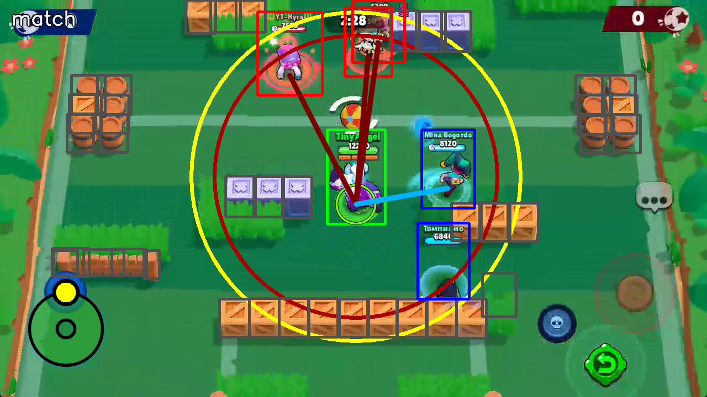

# PylaAI

[](https://creativecommons.org/licenses/by-nc/4.0/)
[](https://discord.gg/xUusk3fw4A)
[](https://trello.com/b/SAz9J6AA/public-pyla-trello)

**An open-source, screen-only bot for Brawl Stars.** PylaAI reads the game from an Android emulator's screen with computer vision, decides what to do, and plays through touch input. It never reads the game's memory and never modifies the client: everything it knows comes from pixels.



> [!WARNING]
> There are two versions of PylaAI. You are browsing the **source code for developers**. Visit our [Discord](https://discord.gg/xUusk3fw4A) to get the compiled, ready-to-use `.exe`.

## What it does

- **Sees the game**: detects players, enemies, teammates and obstacles with object-detection models running on ONNX Runtime.
- **Understands the game state**: lobby, brawler selection, in-match and end screens, with recovery when something unexpected appears.
- **Plays**: movement and attacks are driven by scriptable *playstyles* (`playstyles/*.pyla`).
- **Controls the emulator** through ADB and scrcpy.
- **Local web dashboard** (Flask): settings, brawler queue, profiles and match history.
- **Discord bot** (optional): remote control and notifications for when you're not on your computer.


## Tech stack

| Area | Tools |
| --- | --- |
| Language | Python 3.11 |
| Vision | OpenCV, ONNX Runtime, NumPy |
| Device control | ADB (`adbutils`), scrcpy |
| Interface | Flask web UI, pywebview desktop window, `discord.py` |

## Requirements

- **NVIDIA GPUs**: `setup.py` installs `onnxruntime-gpu` when an NVIDIA GPU is detected, and falls back to DirectML, then CPU, if CUDA does not load.
- **AMD / Intel / iGPU**: DirectML on Windows (`onnxruntime-directml`), with CPU fallback.

## Installation

You need [Python 3.11.9](https://www.python.org/downloads/release/python-3119/).

```sh
python setup.py install
```

The official PylaAI supports Windows only. Cross-platform ports exist: [Unofficial Ports](https://github.com/4D1-TooFarGone/Pyla-Ports).

## Using PylaAI

This open-source version runs in localhost mode; the cloud features are disabled by default.

```sh
python main.py
```

| Flag | Effect |
| --- | --- |
| *(none)* | Console visible, UI in the Pyla desktop window |
| `--no-console` | Hides the console window; output goes to `pyla.log`. Ignored when started from an existing terminal. |
| `--no-webapp` | Opens the UI in the default browser instead of the desktop window |


## Versions and models

This repository is the **free, open-source version** (v0.8.x). It uses the original detection models in `models/`.

The newer versions (v0.9+) are **not open source**. They use four newer YOLO models: terrain segmentation, entity detection with a ground point, game-mode elements and projectile detection.

All the models are open source, including those this free version does not use. They are listed, with their classes and dates, in [BrawlStarsBotMaking](https://github.com/AngelFireLA/BrawlStarsBotMaking#current-available-models).

## License

Not permitted to be sold or monetized, under [CC BY-NC 4.0](https://creativecommons.org/licenses/by-nc/4.0/).

## Maintainers

**Developers**
- **ivanyordanovgt**: original author, February – August 2024
- **AngelFireLA**: main developer, August 2024 – present
- **awarzu**: developer, March – April 2026

**Contributors**: Maayan080, simonrejzek, bocchi-the-cat, Ariko842, Nauwk07, aetherwtff, fazelukario, k00shi, mydd7, Elpo55.
